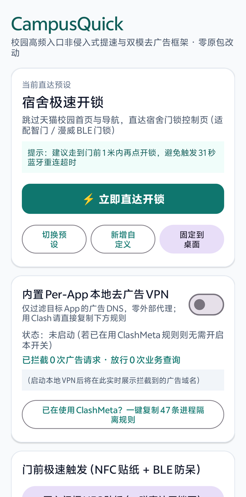
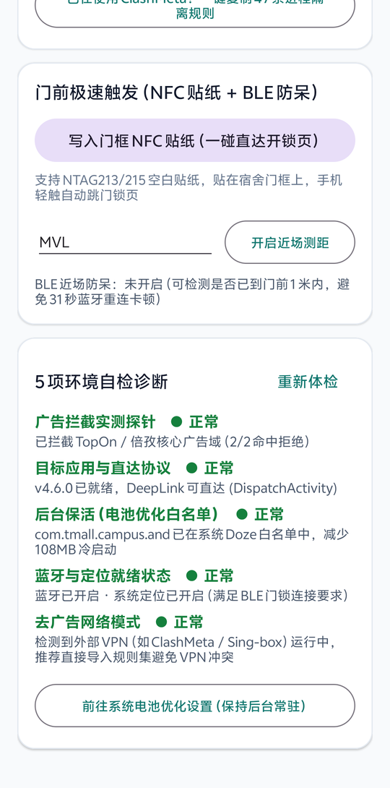
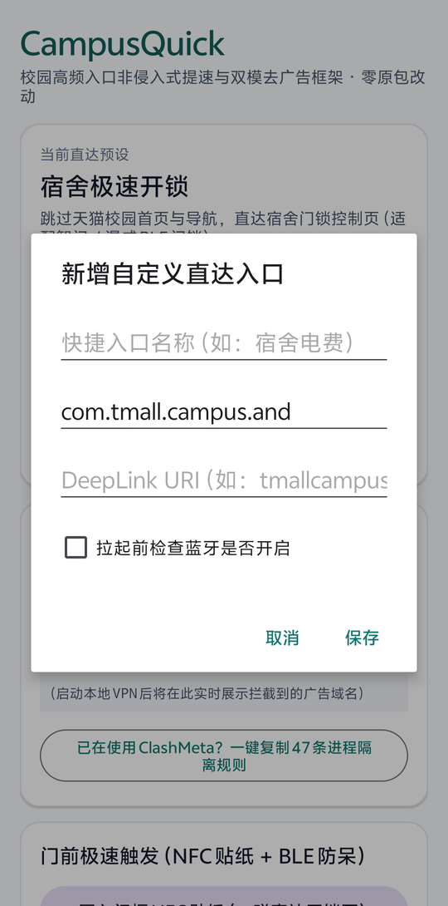
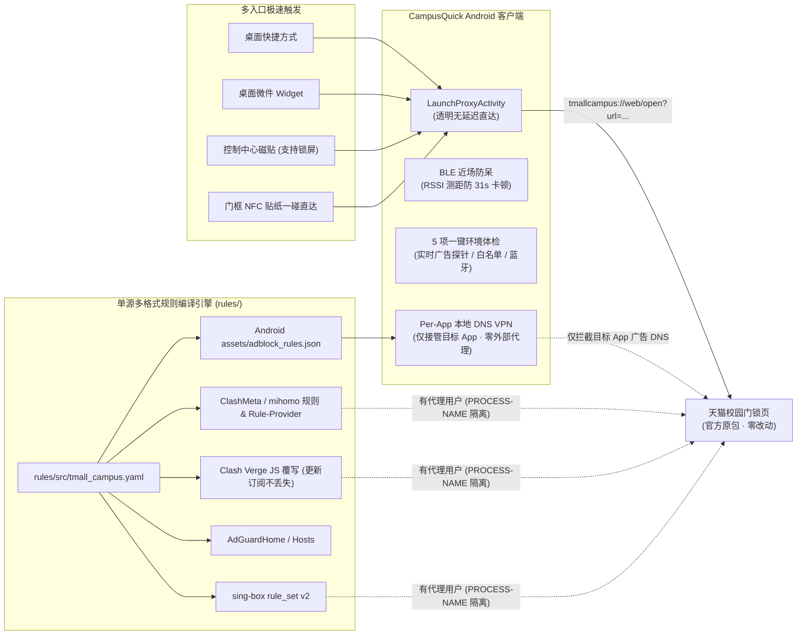

# CampusQuick — 校园高频入口非侵入式提速与双模去广告框架

[](https://github.com/xiwenkou/CampusQuick/actions/workflows/ci.yml)
[](https://github.com/xiwenkou/CampusQuick/releases/latest)
[](LICENSE)

> **零原包改动 · 免 Root · 零账号风控 · 开箱即用**  
> 专为饱受开屏广告、切回热启广告、开锁后全屏插屏与蓝牙长超时折磨的校园智能门锁（首发适配「天猫校园」宿舍 BLE 门锁）打造。

## 快速下载与上手

1. 前往 [**Releases 页面**](https://github.com/xiwenkou/CampusQuick/releases/latest) 下载最新版 `CampusQuick-v*-release.apk`（约 1.7 MB，支持 Android 8.0–15）。
2. 选择适合你的去广告方式：
   - **已在用 ClashMeta / Mihomo / Sing-box**：打开 App 点「一键复制 86 条进程隔离规则」粘到 `rules:` 顶部，或按 [代理配置指南](docs/CLASH_GUIDE.md) 订阅本仓库远程规则集（更新机场订阅不丢失）。
   - **平时不用代理软件**：直接打开 App 内「内置 Per-App 本地去广告 VPN」开关（*已通过 Android 14 真机实测：空闲 `0.0%` CPU、单次冷启拦截 442+ 次广告请求、5/5 环境体检全绿、零外部代理*）。
3. 点「固定到桌面」或下拉控制中心添加 **「一键开锁」** 磁贴，并点击底部按钮将目标 App 加入系统电池优化白名单，日常热启动 **~0.38 秒**直达门锁页。

## 为什么做这个项目？

实机静态逆向与抓包证实，常见校园 App 的慢与烦来自三处根因：
1. **14+ 广告 SDK 瀑布流**：冷启开屏（3.5s + 5s + 6s）、切回热启（60s 触发 6s）、页面横幅与开锁后全屏插屏，且主域名被拒后会自动切换多套二级备用域名（单次冷启动可达 **400+ 次**广告外连）。
2. **安全组件限制**：原 App 内置阿里无线保镖签名校验与 MTOP 账号栈，**反编译改包重签会导致接口异常并存在账号风控风险**，绝不应采用改包方案。
3. **BLE 31 秒重连黑洞**：门锁 SDK 写死 `reconnectCount=2, reconnectInterval=5000ms, connectOverTime=20000ms`，距离门锁过远点击开锁会触发 `status=62` 连续重连卡死 31 秒，而贴门 1 米内仅需 **~2.7 秒**。

**CampusQuick 采用纯非侵入式工程方案**：不动原包一个字节，通过「多入口 DeepLink 直达 + 双模精准去广告 + 近场防呆与自检」把开锁路径压缩到 **~0.44 秒直达门锁页**。

---

## 界面预览

| 主面板与双模去广告 | 门前 NFC / BLE 防呆与 5 项全绿体检 | 自定义任意校园入口 |
| :---: | :---: | :---: |
|  |  |  |

---

## 系统架构



---

## 核心特性

- **四入口直达 + 路由配置化**：支持桌面图标、2×1 桌面微件、控制中心快捷磁贴（Android 14 `PendingIntent` + 锁屏 `unlockAndRun`）、门框 NFC 贴纸（内置 NDEF 写卡器），以及自定义校园 DeepLink 预设。
- **双模精准去广告**：
  - **无代理用户（内置 Per-App 本地 DNS + 直连 HTTPDNS 过滤 VPN）**：利用 `VpnService.Builder.addAllowedApplication()` **仅接管目标 App**，路由虚拟 DNS `10.120.0.2/32` 与常见广告直连 HTTPDNS IP（如 `119.29.29.29/32`），广告域名 < 1ms 返回本地 `NXDOMAIN`、直连 HTTPDNS TCP 请求 < 1ms 返回 `TCP RST`，业务 HTTPS 流量完全不走 TUN；同时内置**最近任务防误杀隐藏、切网自动刷新、开机自恢复与点击一键开锁自动拉活（~50ms 建隧后再拉起目标 App）**，彻底解决国产 ROM 后台强杀导致的时灵时不灵。
  - **代理用户（ClashMeta / Sing-box / AdGuard）**：由单源 YAML 自动编译 6 种格式，对抖音/快手等共享媒体域启用 `PROCESS-NAME` 进程级隔离，不误伤本机正常 App。
- **BLE 近场防呆**：扫描门锁前缀信号强度（默认 `MVL`，可自定义，无个人 MAC 硬编码），到门前 1 米内提示绿灯可秒开，规避 31 秒蓝牙重连超时。
- **5 项实时环境体检**：内置广告域实时连通性探针、DeepLink 可达性、Doze 电池白名单、蓝牙/定位状态、VPN 冲突自动识别。

---

## 目录结构

```text
campus-quick/
├── android/                      # Kotlin + Gradle 8.11 + AGP 8.7.3 Android 客户端
│   └── app/src/
│       ├── main/java/com/campusquick/app/
│       │   ├── core/             # AdBlockMatcher, DnsPacketCodec, DiagnosticsEngine, BleProximityMonitor, NfcTagHelper, RouteLauncher
│       │   ├── data/             # PresetRepository, RuleRepository
│       │   ├── entry/            # LaunchProxyActivity, QuickUnlockTileService, QuickUnlockWidgetProvider
│       │   ├── vpn/              # AdBlockVpnService (Per-App 本地 DNS 过滤), VpnStatsStore
│       │   └── ui/               # MainActivity (Material 3 仪表盘)
│       └── test/                 # JVM 单元测试 (DNS 报文编解码、规则匹配、预设解析)
├── rules/
│   ├── src/tmall_campus.yaml     # 单一规则源（含业务白名单与消费类 App 防误杀守卫）
│   ├── scripts/build_rules.py    # 多平台规则编译器（同时同步至 Android assets）
│   ├── dist/                     # 自动产出的 6 种平台规则文件
│   └── tests/test_rules.py       # Python 自动化回归测试
├── presets/
│   ├── presets.json              # 可扩展的校园路由预设表（零个人隐私）
│   └── schema.json               # JSON Schema
├── docs/
│   ├── TECHNICAL_ANALYSIS.md     # 脱敏技术分析：广告瀑布流与 31s 蓝牙重连根因
│   └── CLASH_GUIDE.md            # ClashMeta / Clash Verge / Sing-box / AdGuard 配置指南
└── .github/workflows/ci.yml      # 规则回归测试 + Android 单测与 APK 构建 CI
```

---

## 快速构建与测试

### 1. 编译并验证去广告规则集
```bash
python rules/scripts/build_rules.py
python -m unittest discover -s rules/tests -v
python rules/scripts/build_rules.py --check
```

### 2. 运行 Android 单元测试并构建 APK
```bash
cd android
./gradlew testDebugUnitTest assembleDebug assembleRelease
```
> **Windows 提示**：若项目位于含中文字符的目录（如 `D:\项目\campus-quick`），Gradle 8 的 `TestWorker` 可能无法解析中文类路径；可临时映射纯 ASCII 盘符运行单测：`subst Q: "D:\你的父目录"` → 在 `Q:\campus-quick\android` 下执行 `./gradlew testDebugUnitTest` → 结束后 `subst Q: /D`。

构建产物位于：
- `android/app/build/outputs/apk/debug/app-debug.apk`
- `android/app/build/outputs/apk/release/app-release.apk`

---

## 权限透明说明与合规声明

本应用坚持最小权限原则，**零广告、零联网遥测、零账号采集、不修改任何第三方 App 安装包**：
- `INTERNET` / `ACCESS_NETWORK_STATE`：仅用于 Per-App 本地 VPN 放行业务 DNS 查询与自检探针；
- `FOREGROUND_SERVICE` / `FOREGROUND_SERVICE_SPECIAL_USE` / `POST_NOTIFICATIONS`：仅在用户主动开启本地去广告 VPN 时保持前台运行；
- `RECEIVE_BOOT_COMPLETED` / `REQUEST_IGNORE_BATTERY_OPTIMIZATIONS`：可选，用于重启后自动恢复已开启的本地 VPN 并一键加入电池优化白名单，防止系统后台强杀；
- `NFC`：可选，用于写入/触发门框 NFC 贴纸；
- `BLUETOOTH_SCAN`（声明 `neverForLocation`）/ `BLUETOOTH_CONNECT`：可选，用于门锁近场测距防呆，Android 12+ 无需定位权限。

### 免责声明

- 本项目仅调用 Android 系统标准公开 `Intent` / DeepLink、快捷方式、NFC NDEF、BLE 广播扫描与本地 `VpnService` 接口；
- 本项目**不包含、不修改、不重签、不分发**任何第三方应用程序源码或安装包，亦不触碰任何用户账号凭证、Cookie 或接口签名；
- 本项目与阿里巴巴集团、「天猫校园」及任何门锁厂商无任何隶属或合作关系，所有代码与规则开源透明，仅供学习交流与个人移动网络体验优化使用。

欢迎通过 Pull Request 补充其他高校路由预设或新广告联盟域名，详见 [CONTRIBUTING.md](CONTRIBUTING.md)。
